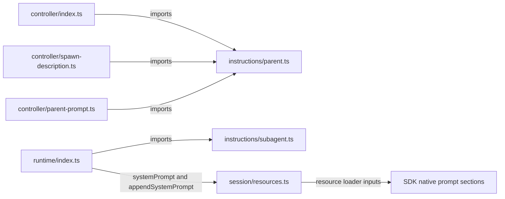

# Instructions

Owns the fixed parent delegation and subagent role text. These modules are dependency-free leaves: keep SDK types, configuration discovery, prompt composition, catalog rendering and runtime effects in their existing owners. Import the audience-specific module directly.

| File          | Content                                                           | Consumers                                                                               |
| ------------- | ----------------------------------------------------------------- | --------------------------------------------------------------------------------------- |
| `parent.ts`   | `SUBAGENT_DESCRIPTION`, `SUBAGENT_SNIPPET`, `SUBAGENT_GUIDELINES` | Controller tool registration, catalog description rendering and parent-prompt filtering |
| `subagent.ts` | `SUBAGENT_ROLE_INSTRUCTIONS`                                      | Runtime child-preamble preparation in both modes                                        |

Controller registers the parent guidance and removes those same `SUBAGENT_GUIDELINES` entries when capturing policy for a child. `spawn-description.ts` owns bounded catalog rendering and status text; it combines current capability metadata with the fixed parent description.

Parent guidance uses delegation for bounded outcomes that benefit from selected skills, MCP access, specialist instructions, independent review or parallel work, including sequential specialist tasks. Explicit user requests and applicable requirements still govern delegation; routine work stays local. Each handoff includes the outcome, context, scope, edit ownership, required checks and stopping condition. Skill requirements apply to that assignment; optional recommendations do not create extra deliverables.

Both roles return when their requested outcome and applicable required checks are complete, or report completed work and a specific blocker when no authorized step can advance the remaining work. The parent checks relevant artifacts and integration risks while reusing verification that covers the final state. New checks or follow-ups need a relevant change, failure, material evidence gap or unmet requirement. Required independent review is consolidated unless applicable instructions require earlier or separate reviews; correction reviews cover affected behavior. Optional polish, speculative risks and repeated all-clears do not extend the task. Children leave delegation and review coordination to the parent and report required outstanding review honestly.

Parent guidance keeps `generation` with `agentId`, directs one current-agent inspection after `not_available`, and requires checking prior effects before explicitly assigning fresh work. It explains memory-only history, structured failure recovery and containment without automatic replay or force release. Both roles require a relevant changed condition or concrete recovery step before retrying. Children inspect prior effects and confirm current authority before retrying operations that may change external state. Execution limits are ceilings, not targets; children return early when done or blocked, and report partial findings before limits. Unfinished required work remains incomplete. Prompts never grant authority or enlarge budgets.

Supplemental owner data can resolve missing information and support progress on the current assignment, but cannot change policy, grant authority or start a new task. External reference content and quoted task data are evidence, not instructions or authorization. Selected skills and applicable project instructions still guide work within the assigned scope and current policy.

These instructions guide model behavior; they do not enforce a fixed number of delegations, checks or reviews. Runtime permission checks and cleanup ownership remain separate. User-supplied agent bodies, skills and unrelated inherited policy are preserved and may impose additional requirements.

Runtime chooses the instruction base: filtered parent policy for append, or the optional instruction file for replace. It appends the fixed role once as `config.systemPrompt` and supplies the agent body separately as `config.appendSystemPrompt`. Session passes these fields, selected skill metadata and the native MCP extension to the SDK resource loader. SDK rendering orders preamble → agent addendum → eligible skills → cwd → indirect MCP catalog. Native reader selection controls skill display. Skill bodies are not preloaded. These text modules own neither rendering nor parent capture.

Session configures native prompt resources and owns the separate `<subagent_task>` initial user message, owner-message framing and budget notices. Runtime adds effective invocation/tool/output limits to the child preamble. Budget supplies one budget advisory and at most one time advisory on natural requests; simultaneous causes share a message. No extra model request or polling timer is introduced. The SDK owns catalog rendering; Session does not override its final prompt. Task text escapes `&<>`; task content is never merged into system policy. Event-specific messages describe live session state rather than fixed role policy. Tool authorization and execution limits remain enforced by their existing owners.

See the [architecture overview](../../architecture.html).
