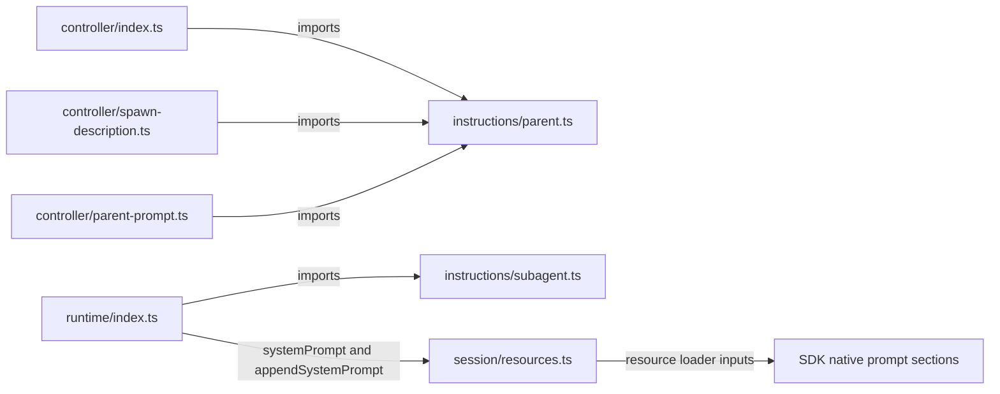

# Instructions

Owns the fixed parent delegation and subagent role text. These modules are dependency-free leaves: keep SDK types, configuration discovery, prompt composition, catalog rendering and runtime effects in their existing owners. Import the audience-specific module directly.

| File          | Content                                                  | Consumers                                                                               |
| ------------- | -------------------------------------------------------- | --------------------------------------------------------------------------------------- |
| `parent.ts`   | `SPAWN_DESCRIPTION`, `SPAWN_SNIPPET`, `SPAWN_GUIDELINES` | Controller tool registration, catalog description rendering and parent-prompt filtering |
| `subagent.ts` | `SUBAGENT_ROLE_INSTRUCTIONS`                             | Runtime child-preamble preparation in both modes                                        |

Controller registers the parent guidance and removes those same `SPAWN_GUIDELINES` entries when capturing policy for a child. `spawn-description.ts` owns bounded catalog rendering and status text; it combines current capability metadata with the fixed parent description.

Runtime chooses the instruction base: filtered parent policy for append, or the optional instruction file for replace. It appends the fixed role once as `config.systemPrompt` and supplies the agent body separately as `config.appendSystemPrompt`. Session passes these fields, selected skill metadata and the native MCP extension to the SDK resource loader. SDK rendering orders preamble → agent addendum → eligible skills → cwd → indirect MCP catalog. Native reader selection controls skill display. Skill bodies are not preloaded. These text modules own neither rendering nor parent capture.

Session configures native prompt resources and owns the separate `<subagent_task>` initial user message, optional preceding reference warning/JSON, owner-message framing and budget notices. The SDK owns catalog rendering; Session does not override its final prompt. Task text escapes `&<>`; neither task nor reference content is merged into system policy. Event-specific messages describe live session state rather than fixed role policy. Tool authorization and execution limits remain enforced by their existing owners.

See the [architecture overview](../../architecture.html).
